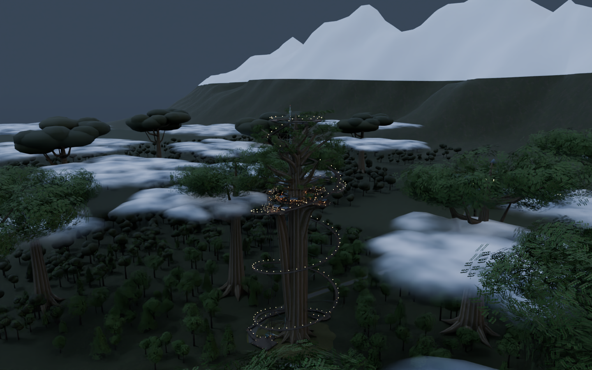
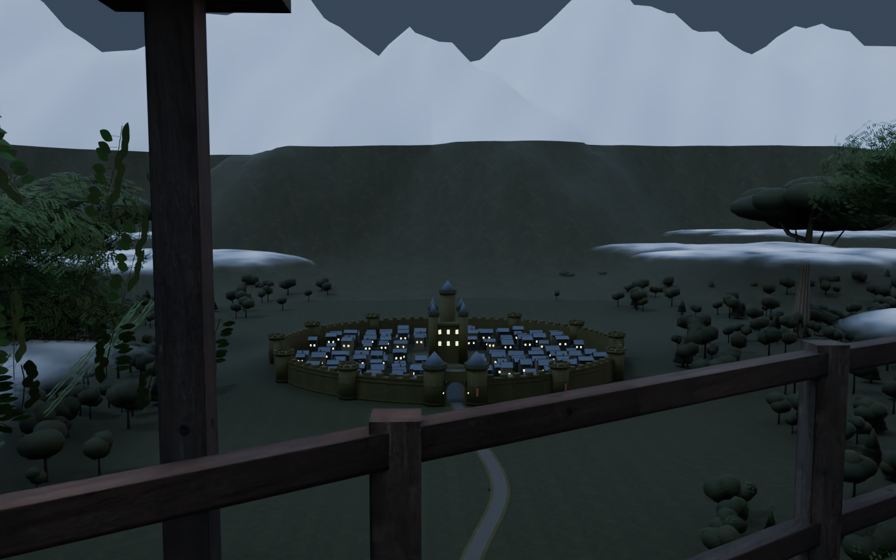
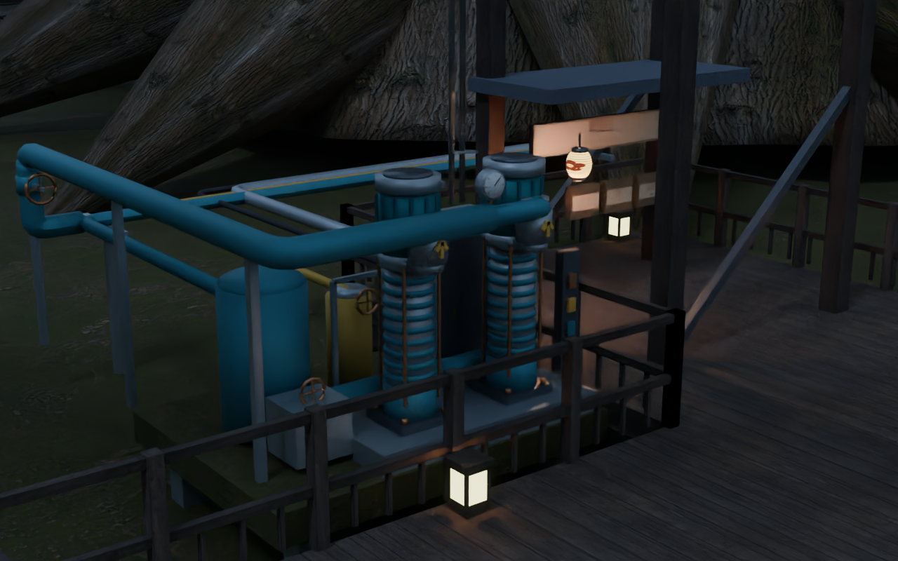
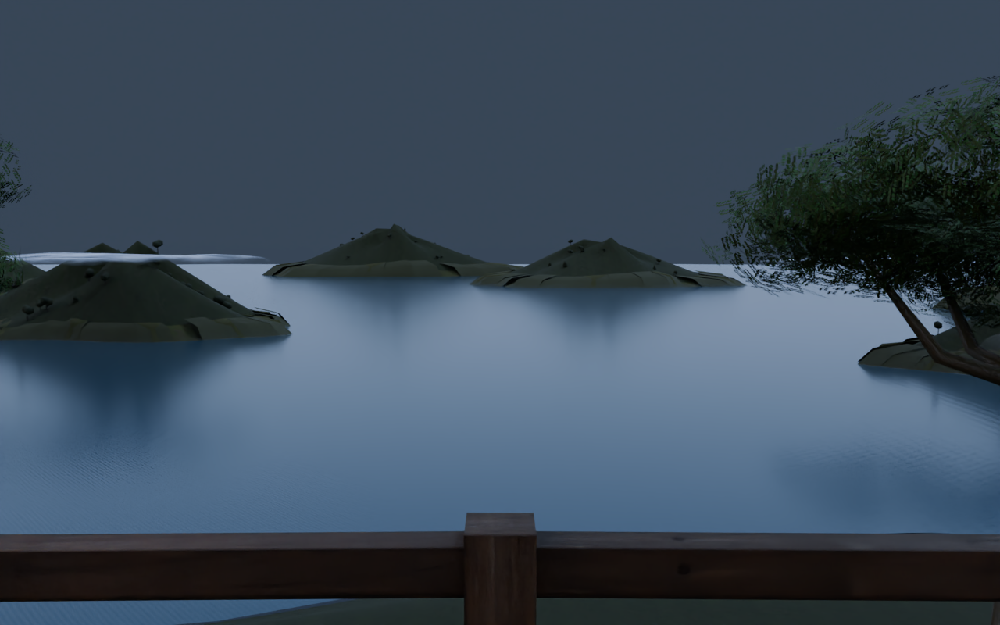

# v2.6.0-source-preview — 雲海の上の横丁と多段ポンプ

## 今回の変更

- カメラだけでなく、横丁の床・建物・座席・転送先・透明壁を100m上へ移設。G0=0m、L1=134m、L2=140m、L3=146m、L4=152m
- 地上から212mの樹冠まで1,416段の連続階段を再生成。途中の既存デッキとの接続も保持
- 110〜124mに28群・252房の丸い雲。8描画バッチ、36,288三角形、追加テクスチャなし。北と南に実際の隙間を確保
- 周囲の巨木も高くし、近景の不透明な樹冠の芯を葉群へ置換。城壁石積み・城門・屋根・海岸の岩層と波際を追加
- 地上の双発ポンプ、52mと102mの中継設備、155mの上部貯水台。計6基の多段ポンプ、支持架台、逆止弁・仕切弁・計器と配管
- L4と外周橋の透明壁にあった約14cmの角の隙間を、両側へ重なる接合材で閉鎖
- 上部の階段に干渉した太い枝を移動し、実際の樹皮メッシュも通路から離す
- 反射Probeとエディター初期視点を移設後の高さへ追従。地上用Probeは固定

ポンプは架空世界の視覚的な設備です。実在機器の揚程・流量・水質・安全性を保証する工学設計ではありません。

## 検証

- 全4,720床サンプル、座席退出先、転送先、透明壁の交差検査
- 実壁を差し引いた各階の半径0.25m経路連続性
- 地上〜樹冠の実衝突メッシュ、7,471区間の連続身体余裕、床支持と頭上余裕、接続部
- 舞台の連続床・頭上・四方の視線、インフラの地上〜上部接続
- 雲の実高度、公共床との距離、ポンプ・貯水の高度、反射設定

[検証記録](Validation.md)、[樹冠経路](crown_validation.json)、[高度と設備](altitude_validation.json)、[独立レビュー](IndependentReview_2.6.0.md)

## 同じ版の画像

同梱GLBを実際にBlenderで描画した形状・材質プレビューです。雲の材質はUnityシェーダーに対応するBlenderノードで表現。Unity／VRChat実機画面ではありません。

## 未実行

Unity / Udon / Shaderコンパイル、ライトベイク、Windows Build & Test、VR実機・GPU時間は未確認。約50MBは最終Windowsワールドの目標で、実ビルド容量は未測定です。ソースZIP・GLBの容量とは異なります。
