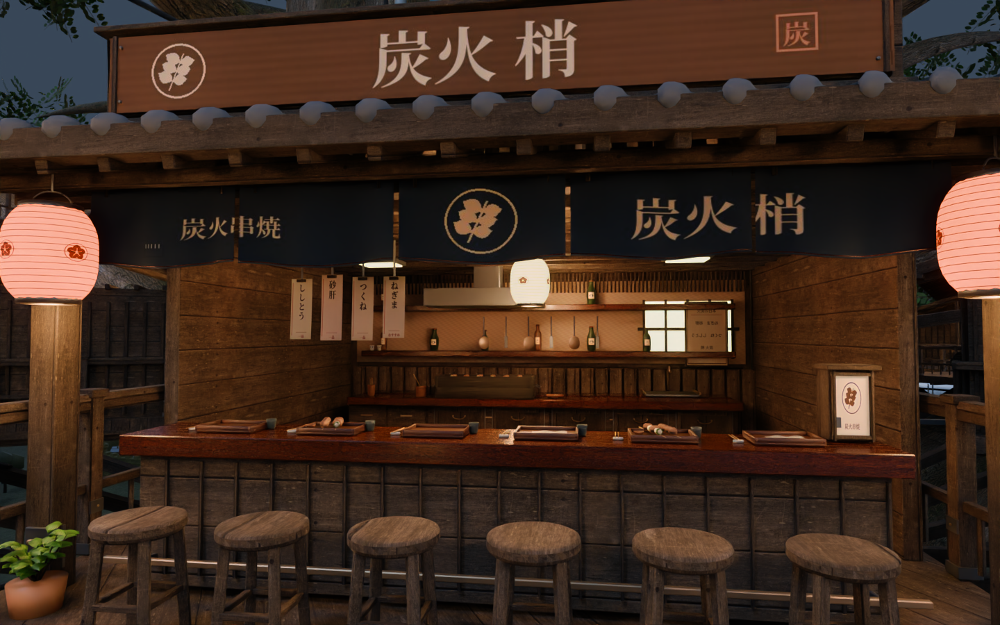
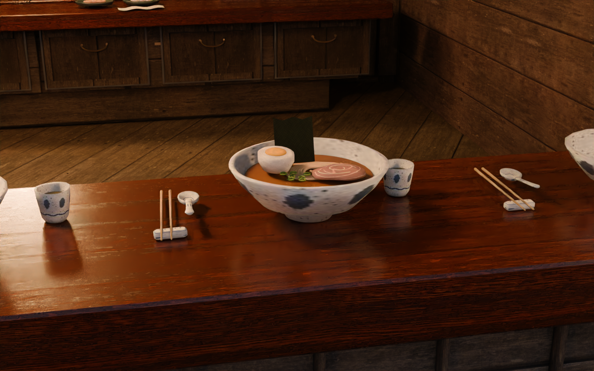

# v2.7.0 — 店先の手仕事 / source preview

歩いて近づいた時の魅力を高める改修です。Unityで実行・ビルドしたワールドではなく、Windows向けVRChat制作ソースのプレリリースです。

## 改修

- 8店舗それぞれの暖簾、紋、書体、木看板、短冊メニュー、卓上の和紙灯
- 木目の方向を部材の長手へ合わせ、近くの木部を面取り。木栓・方杖・金物・引手・雨樋を追加
- 焼鳥・麺・おでん・酒・茶・小皿・甘味の器、食品、道具、瓶と棚を個別に制作
- 丸椅子の座面と貫、提灯の紙・骨・吊り手、連続する手摺の柱間を再制作
- 材質アトラスを共有し、小さな棚の器や手摺金物・提灯の骨の分割を調整
- レンダー入力のGLBハッシュを描画開始時に固定。実シーンの法線・アルベドでノイズ除去できる再現用スクリプトを追加

## 実画像

同梱GLBをBlender Cyclesで描画した、形状・PBR材質のプレビューです。Unity / VRChat実機のスクリーンショットではありません。

JSONにはカメラ・レンズ・入力GLBのSHA-256を記録。ソースZIPには今回の2枚の元レンダーPNGも収録します。

## 検査と規模

- `Source/run_checks.py` のオフライン資産・床・壁・通路・樹冠・樹皮・舞台・設備・高度・店先検査: 合格
- 49席、12移動コントロール、既存の床・階段・落下防止壁を維持
- 599個の樹木・遠景・樹冠バッチの位置・三角形がv2.6と一致
- 描画ソース: 2,708,765三角形、1,022バッチ
- 圧縮した編集用描画データ: 31,863,390バイト。これはVRChatダウンロード容量ではありません

元の設定資料は変更していません。共有材質・小物制作の説明は[ShopCraft](ShopCraft.md)、検査結果は[Validation](Validation.md)を参照してください。

## 継続する確認

約50MBは最終Windowsワールドの目標で、実容量は未測定です。Unity / Udon / Shaderコンパイル、ベイク、VRChat Build & Test、VR実機確認は未実施です。

従来からあるカウンター両端の隙間は店員側への0.50m径・頭上2.2mの経路条件を満たしていません。合格した客席・退出先の検査とは区別し、後続改修で扱います。食品は極端な接写では模型感が残るため、引き続き表面と形を調整します。

### 後続の拡張検査で判明した範囲（v2.8制作時）

v2.7の合格は当時の店舗・手摺と指定領域に限られます。後から全描画へ拡張した検査で、既存の枝・昇降機前の飾り・一部電柱との干渉を確認しました。またUnityの葉画像のClamp設定とUV依存の風変形に、Blenderプレビューには現れない問題を確認しています。v2.8で修正し、個別に再検査します。v2.7を全描画・全歩行動線の検査済み版として扱わないでください。
