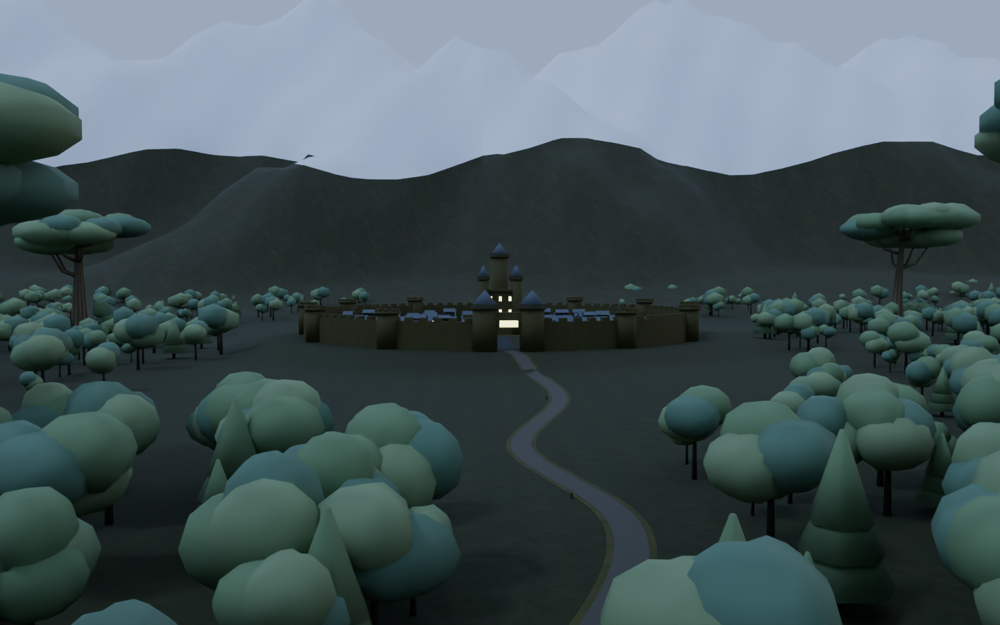
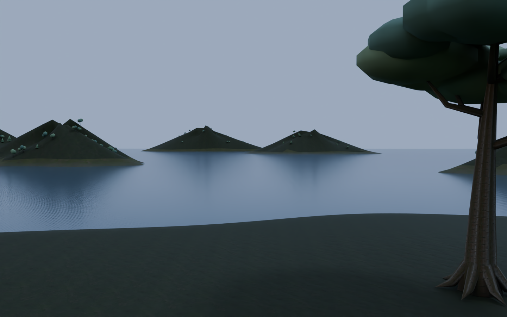

# v2.2.0-source-preview — 眺望レイアウト・通路安全修正

Windows向け制作ソースのプレリリースです。Unity / VRChat実機検証済みのワールドファイルは含みません。

## 改修

- 真下を森林へ変更。樹上横丁の巨木に匹敵する16本の巨木を周囲へ配置
- 北の街道から円形城郭都市へ接続。137棟、18塔の城壁と中央城館
- 都市の奥に雪の稜線を持つ山脈。反対側の南は海と6つの島
- 既存8店舗・49席、PBR木材・樹皮・岩材、提灯の横丁を保持
- W05がR03側壁を横断していた問題を解消。W04も階段壁の角を回避
- 床だけでなく、実際の透明壁と店舗の固体障害物を差し引く通路検査を追加
- BC7/BC5のWindowsテクスチャ設定、ベイク主体の灯り、圧縮メッシュ分割入力

遠景は配置・スケールを確認する制作途中の段階です。樹冠の葉、城壁・街並み、海岸と雪山の材質・細部は次段階で磨き込みます。

## 画像

Blenderの形状・材質プレビューです。Unity／VRChatの実機スクリーンショットではありません。プレビュー用の照明・空・霧・標準OIDNノイズ低減を使用しています。

## 検証と残作業

実測したソース規模と検査結果は[Validation.md](Validation.md)、[WindowsProfile.json](WindowsProfile.json)に記録。

Unity C# / UdonSharp / Shaderコンパイル、ライトベイク、Unity Physics Audit、ClientSim、Windows Build & Test、VR実機・複数人の性能は未確認です。約50MBは最終Windowsワールドの目標で、実ビルド容量は未測定です。

配管・電線・通信設備、連続した地上〜樹冠の階段、能舞台風ステージは、続く別の改修段階で追加します。同梱モジュールがある場合も、この版ではまだ生成に組み込んでいません。
