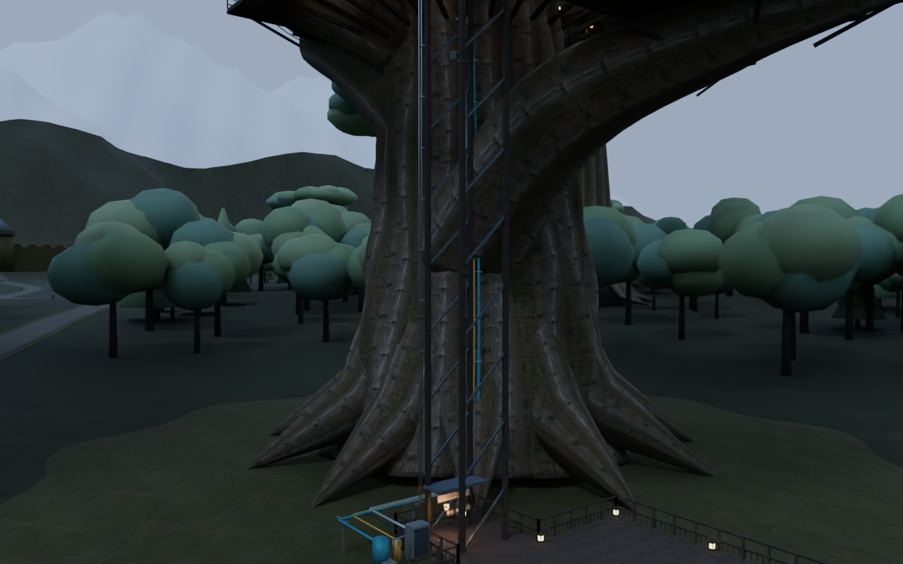
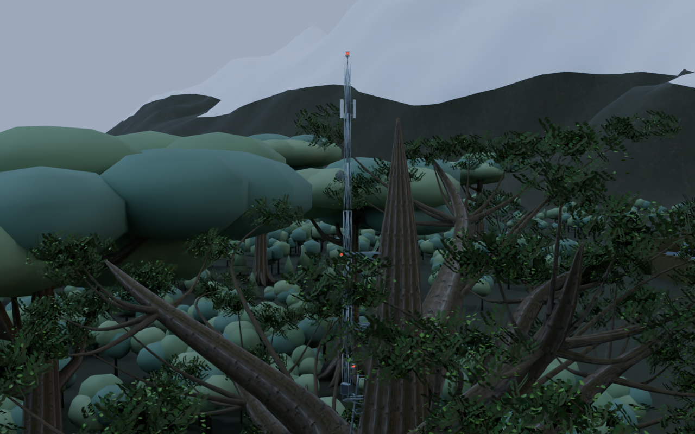

# v2.3.0-source-preview — 配管・配線・通信設備

v2.2の配置／安全修正版に、地上から巨木へつながる生活インフラを追加した制作ソースです。

- 地上の受水槽・ポンプ・ガス設備・電気盤から幹へ連続する配管と導管
- 水道Z52、ガスZ46、電気・通信Z94までの立ち上がり。82か所の固定金具
- 通路に60本の電灯、配線、分電箱、デッキ下の配管網
- 樹冠上の支柱・アンテナ3面・通信皿・赤い障害灯3灯
- 障害灯専用シェーダーは2秒周期、16%点灯時間。ベイク光・静的バッチから除外

配管の端点接続・高さ、点滅ロジックのソースと周期、既存通路のオフライン形状検査を確認。Unity内のシェーダー実行は未検証です。

## 同じ版のプレビュー

Blenderによるモデル／材質プレビューです。Unity／VRChat実機画面ではありません。赤灯は静止画用の点灯姿勢です。

## 限界と次段階

遠景は配置段階のままです。葉・城郭・海岸・雪山の質感、地上〜樹冠の連続階段、能舞台風ステージは次の改修へ進めます。

Unity / Udon / Shaderコンパイル、ベイク、Windows Build & Test、VR実機試験は未実行。約50MBは最終Windowsワールドの目標で、実容量は未測定です。

[検証結果](Validation.md) / [インフラ検査](infrastructure_validation.json)
