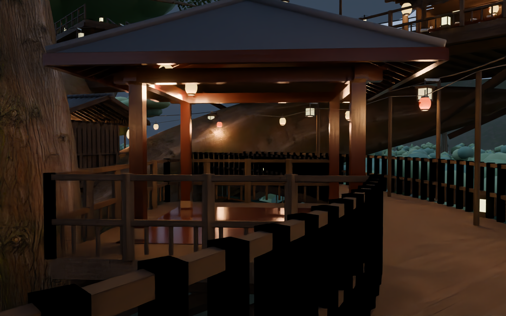
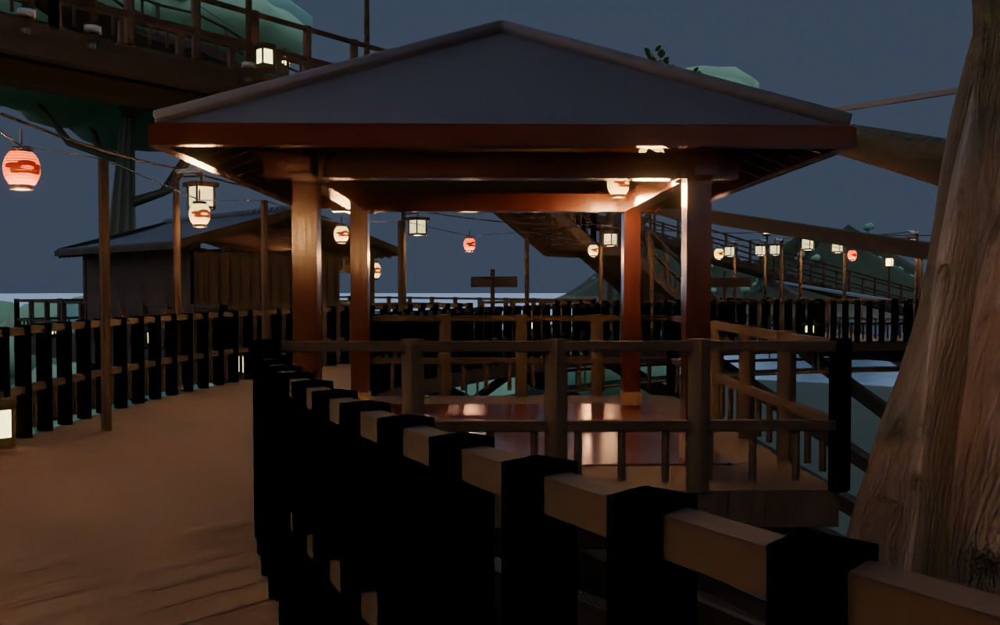

# v2.5.0-source-preview — 周囲に開いた能舞台風ステージ

主環状路の内側へ、四方に壁を持たない檜色の舞台を追加。

- 4.2m角の演技床、4本の柱、入母屋ではなく四面に下る寄棟の屋根
- 松の高い意匠、梁・垂木、提灯。目の高さに背面壁を作らず周囲から見える構成
- 舞台の外周床をL2の連続床へ統合し、以前の内周防護壁が入口を横切らないよう再生成
- 4本の柱のBoxCollider、5床サンプルを追加。舞台から環状路への身体余裕も検査
- 新旧の橋床が同一面に重なる箇所は見た目の仕上げだけ8〜14mm上げ、衝突床は正確な高さを維持

## 検証

既存の形状・通路・地上〜樹冠の独立衝突検査に再合格。

実際の舞台描画メッシュを使い、演技領域の2.6m頭上余裕、四方から中央を見る目線、物理床が舞台を覆うことを追加検査。[結果](stage_validation.json)

## 同じ版の画像

Blenderのモデル・材質プレビューです。Unity／VRChat実機画面ではありません。

## 残る確認

次の遠景仕上げでは、近い樹冠を葉で形作り、城郭・海岸の細部を追加します。

Unity / Udon / Shaderコンパイル、ライトベイク、Windows Build & Test、VR実機は未確認。約50MBは最終Windowsワールドの目標で、実ビルド容量は未測定です。
