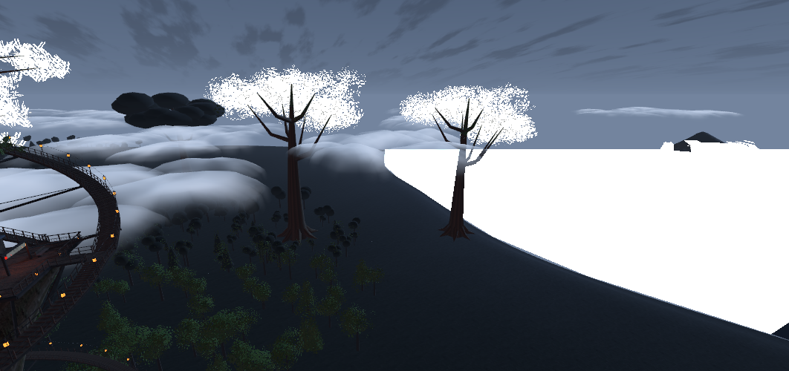
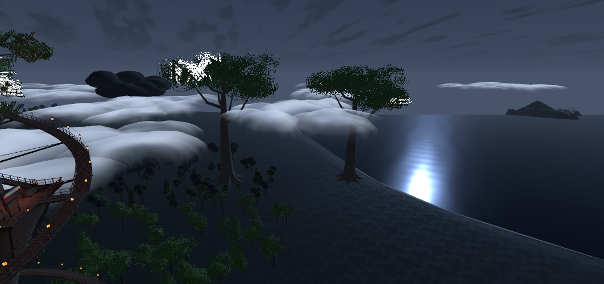
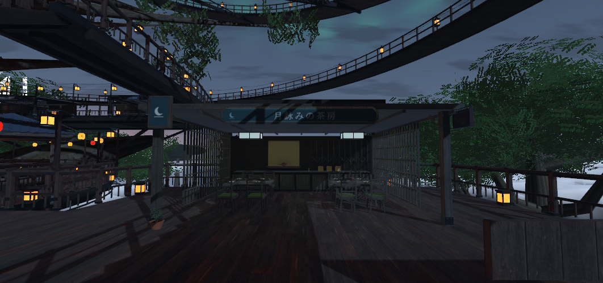
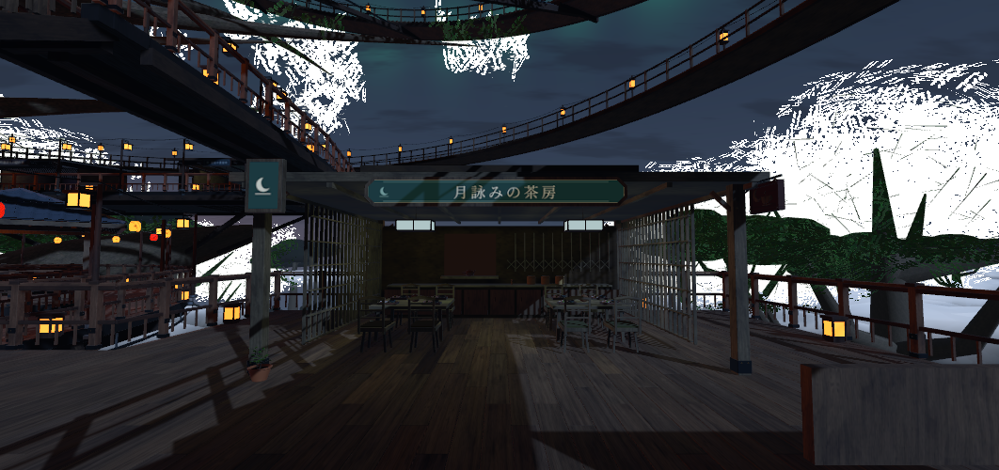

# Unity 2022.3 / SDK 3.10.5 ローカル修復の検証

元コミットは `13fb6c60df026f6b96ddbfe9eb20370ad1559cb5`。Unity MCP を接続し、実エディターで確認した結果である。
生成シーン、SDK バンドル、個人音源、認証情報、エディターログはリポジトリに含めない。

## 描画とベイク

遠景水面が白くなる原因は、横丁周辺の LightProbe を遠景へ外挿していたことだった。同じ画素の HDR 青成分は約 50.94 から 0.11 に低下した。遠景 186 Renderer は環境光を使用する。雲シェーダーは変更していない。

| 修正前 | 修正後 |
| --- | --- |
|  |  |
|  |  |

茶房看板は専用に複製した材質の `_Emission` を 0.35 に設定し、影の中でも文字を読めるようにした。他の看板の材質は変更していない。

ベイク UV 重複は 836 オブジェクトから、初回修復後 11、最終修復後 0 になった。細かな部材の一部には、メッシュ全体で約 1 ピクセルしか照明が割り当てられていなかった。

- 最終的に主要メッシュ 294 個を複製して UV2 の間隔と受光密度を調整。535 個の小物と 11 個の薄い装飾は、既存 Probe の位置に固定したアンカーで受光する。
- 305 個の初回 UV2 複製について全三角形の位置を元シーンと比較し、不一致は 0。後に 11 個は元メッシュへ戻して Probe 受光にした。コライダーや配置は変えていない。
- 最終ライトマップは 2048×2048 が 3 枚、LightProbe は 2,841 点、反射は 7 個。実際に再ベイクを行い、最終ベイク区間で新しい UV 重複警告が無いことを確認した。
- メッシュ面とチャート間隔・解像度の関係は [Unity の UV overlap 解説](https://docs.unity3d.com/2022.3/Documentation/Manual/ProgressiveLightmapper-UVOverlap.html) に従って確認した。

### 同様のシーンを修復する手順

1. 既存シーンを保存し、元のベイク割当がある状態で `9b - Repair Lightmap Detail Allocation` を実行する。
2. 修復ツールはシーンのバックアップと別のメッシュアセットを作る。進行と終了を `Logs/TreeTopYokochoLightingRepair-*.txt` で確認する。
3. 修復完了後にライトマップと反射を再ベイクする。同じシーンへの修復の二重適用は拒否する。
4. `2 - Audit Physics`、入口/PBR の監査、ClientSim、SDK のローカルビルドで再検証する。

既存の水面だけを直す場合は `9 - Repair Distant Light Probes` を使用できる。新規構築でも遠景への Probe 外挿を無効にした。

## スクリプトと構築

- Udon に公開されていない `TextMesh.text` を `UI.Text` に変更し、必要な UdonSharpProgramAsset をインストール前に作成するようにした。
- 静的フォントの生成頂点による表示枠検査に変更。BGM の二行エラー表示も予約領域内に収めた。
- ソース/モデルテスト 78 件がローカルで成功。CI は Windows と Linux で同じ検査を行う。CI は Unity、Udon、VRChat を実行しない。
- 通常の Menu 0 一括構築で core、OriginalPbr、EntrySystems の三つを導入・監査できた。[限定互換修復版](../../LOCAL_REPAIR_REVISION_20261015_JA.md) で元の固定値を保持し、任意の変更を拒否する。
- 固定値の旧版一致と修復版一致が成功し、異なる元ハッシュ・異なる修復後ハッシュが拒否されることを実コードで確認した。

## 計測の限界

最終 ClientSim 試験は 127 判定のうち初回 123 成功、着席 4 件が失敗した。移動と Interact を同一フレームで発火した試験を見直し、別フレームで再確認すると対象 4 席の着席・退出がすべて成功した。初回の失敗記録は保存している。最終的に 15 ワープ、49 席の着席・退出、落下復帰、移動設定、時刻切替、BGM の再生・停止・自然な曲末リピートを確認した。操作盤の実 UdonBehaviour.Interact も 6 ボタンすべて成功した。

最終シーンで Udon コンパイルのエラーは 0、入口と PBR の監査は成功。BGM はユーザー指定の 1 曲で、自動開始、音量 0.025、空間化なし。実際の AudioSource 再生・停止と約 159 秒の曲末リピートを観測した。これはヘッドセットでの聴感評価ではない。

物理監査は 17,858 checks / 43 barriers / errors 0。これは raycast と配置検査であり、VR 実機の連続歩行や身体寸法の検証とは異なる。

時刻の雰囲気・主光源は変化するが、ベイク GI と反射は固定である。複数人同期、途中参加、オーナー交代、VR ヘッドセット、Quest は今回のローカル検証に含めない。

約 230 万三角形と 1,148 core Renderers はプロジェクトのレビュー目安を超える。物理安全性と形状を維持するため、三角形や主要構造を削除して閾値だけを満たす変更はしていない。Editor の計測を VR の FPS 保証として扱わない。

ユーザー指定の音源は公開リポジトリへ再配布せず、ローカルのプレイリストに設定した。テンプレートは MP3 未同梱でも OFF / NO MP3 の安全な状態で動作する。

## BGM の差し替え

MP3 の取り込み先は `Assets/TreeTopYokochoEntrySystems/Music`。曲を追加・削除して Unity のインポート完了を待ち、`Tools > TreeTop Yokocho > 8a - Refresh Local MP3 Playlist` を実行してシーンを保存し、再アップロードする。実行中のワールドが PC のフォルダーを自動走査するわけではない。複数曲では直前の曲を除いてランダム選曲し、1 曲では同じ曲を繰り返す。音量と自動開始の設定は更新時に保持する。`Assets/TreeTopYokocho/Audio/CanopyWind.wav` は独立した風の環境音であり、BGM 取り込みの対象ではない。
