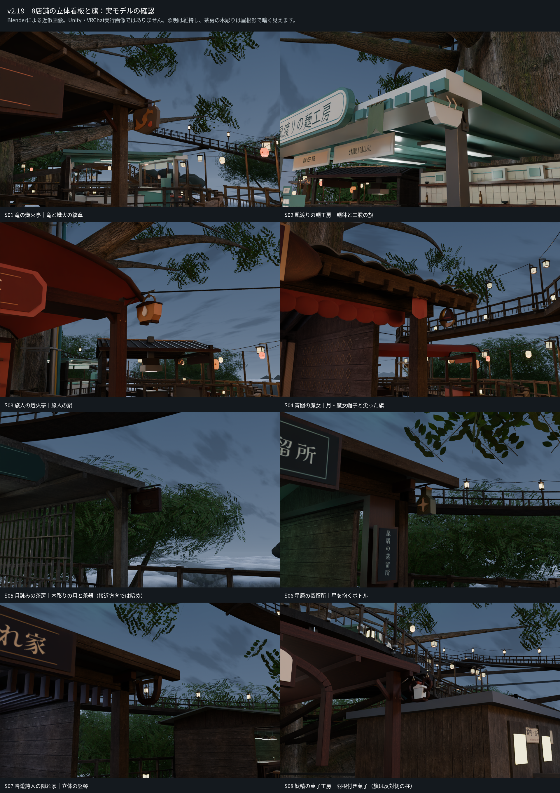
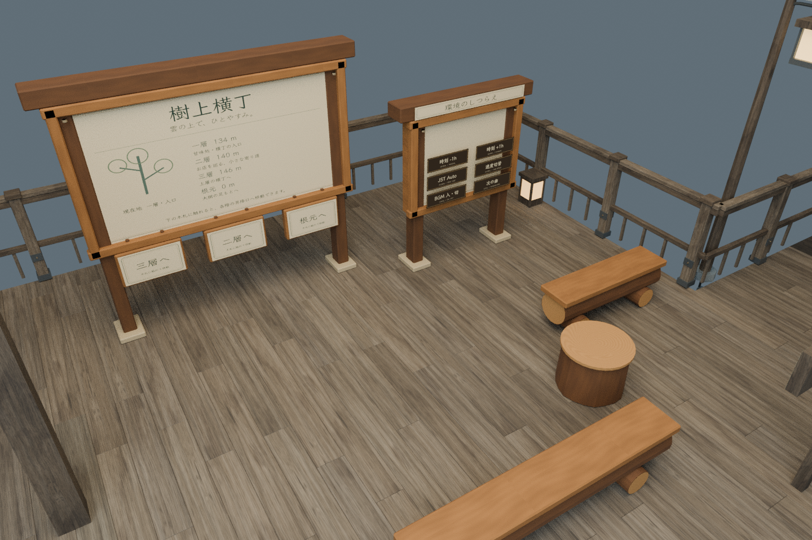
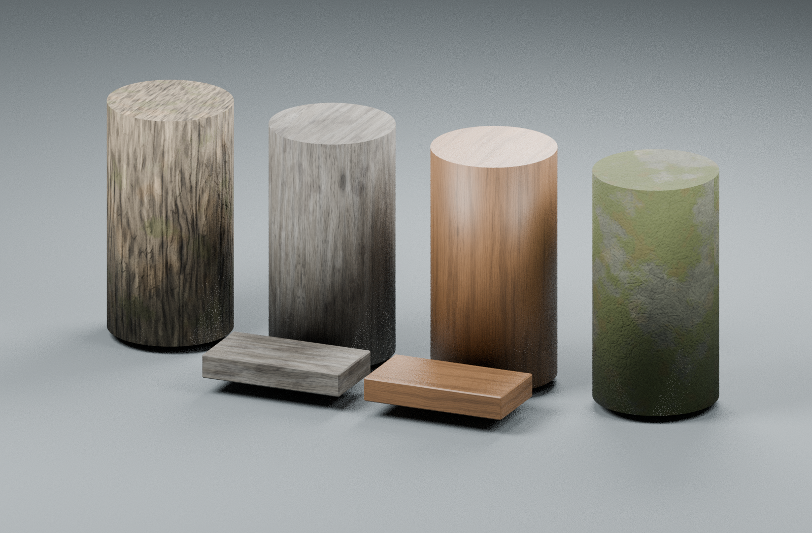
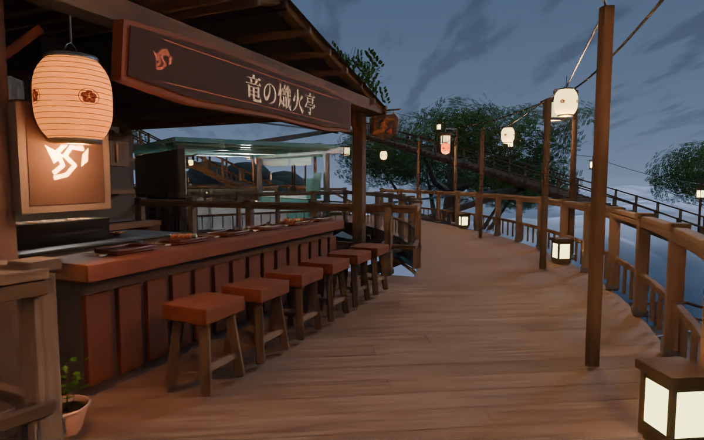

# 樹上横丁 / Tree-top Yokocho

## v2.20.0-preview.1 統合ソース・プレビュー

**編集用ソースです。コンパイル済みワールド、Unity検証済みパッケージ、VRChatへ公開済みのワールドではありません。**

既公開 v2.19.0 の世界・形状・店舗・照明をそのまま保存し、入口の案内／休憩広場／木札ワープ、共有時計、個人BGM操作、自作PBR素材用の導入層を同じ制作プロジェクトへまとめます。配布パッケージの版と、不変のcore形状の版 `2.19.0` は別です。

### 配布ファイル

Releaseの添付 `TreeTopYokocho_v2.20.0-preview.1_integrated_source.zip` が、比較画像と派生GLBを含む全ソースです。GitHubが自動生成する `Source code (zip)` は同じ配布物ではありません。Git checkoutでは大きな派生GLBを含まないため、オフライン全検査／Blender再描画の前に `Source/run_checks.py` で再構成します。Unity向けのnative shardとAssetsはGitにも含まれます。 `.gitattributes` はテキストをLFに固定し、元のCRLF付き同梱ライセンスだけを変換対象から除外します。Windowsのautocrlf設定でも、認証対象のソースhashが変わらないようにしています。

### 標準の入口はメニュー0

1. VCC Worlds、Unity **2022.3.22f1**、Worlds SDK **3.10.5**、Built-in、Windows x86_64 の作業用コピーを用意します。これは制作基準であり、現在の最新版という意味ではありません。
2. 同じ配布物の **Assets 全体**をコピーし、インポートとコンパイルエラーを解消します。既存の Packages / ProjectSettings を丸ごと上書きしません。
3. `Tools/TreeTop Yokocho/0 - Build or Complete Preview` を実行します。対応coreがない場合は生成し、同じsceneへ自作材質とEntry Systemsを追加、scene構造監査後に保存します。
4. Udonコンパイル、ベイク、Build & Test、複数人・音声・VRの試験は別途必要です。[Unity/MCP手順](Docs/MCP_UNITY_SETUP_JA.md)に従って実施し、[検証記録](Docs/MCP_UNITY_VERIFICATION_TEMPLATE_JA.md)へ結果を残します。

同じ完全な導入状態でメニュー0を再実行しても、world・入口・材質を重複生成しない設計です。部分導入、他版、参照の変更、未保存の編集は勝手に上書き・削除せず停止します。**この再実行／保存・再読込の動作はソース検査のみで、Unity上では未実施です。**

旧 `1 - Build World` は **core-only の履歴再現・診断用**です。メニュー1だけでは自作材質、入口、時計、BGM操作が揃いません。通常導入はメニュー0を使ってください。

`Source/TreeTopYokocho.glb` も形状・履歴再現用の元coreデータで、旧材質を保持します。このGLBを単独で開くことは統合版の導入ではありません。自作PBRへの結線はメニュー0の専用overlayで行います。

### 維持したもの

- 実際に造形の違う8店舗。屋根、内装、カウンター、椅子、看板、作業場を店舗別に構成。
- 夜の店舗はスナック、カクテルバー、音楽バーの **3/8店 = 37.5%**。正確な30%ではありません。
- RPG店名とライセンス付き日本語書体、8つの立体看板、3つの静的な布旗、木の茶房サイン。旗の風アニメーションはありません。
- 店舗内15灯の個性ある配色を含む既存374灯、布・和紙・釉薬・水・葉・雲・空などのshader経路。
- 49席、既存12lift移動、通路、床、ガード、落下復帰、平面mesh削減。新しい看板やEntry Systemsは既存の最適化を巻き戻しません。

これらは今回初めて作った機能ではなく、v2.19から維持したものです。coreのソース値は2,304,649三角形・1,145バッチ。実測draw callやFPSではありません。

### 今回まとめたもの

- 入口案内板、小さな休憩広場、丸太ベンチ2脚、切株卓、根元／二層／三層へ行く木札ワープ3個。既存床を使い、新しい床板やライトは増やしません。丸太家具は静的造形で、新規VRCStationではありません。
- インスタンス共有の24時間時計。手動±1時間、JST Auto、2/5/10/30/60倍から実JST1倍へ戻る速度切替。初期状態は手動18:30。
- 自分だけに作用するMP3のON/OFF・次の曲。複数の再生可能曲がある場合、直前の曲を避けてランダム選択します。全曲を一巡するまで重複しない方式ではありません。
- 自作PBR用の専用導入層。31材質定義のうち実使用30材質を対象とし、未使用のMoss定義も区別して保管します。対象のtexture slotと非ゼロparallaxの限定補正以外は、元のshader、tint、UV倍率、数値、形状を維持します。

### 音楽と時刻の重要な限界

**MP3楽曲は未同梱です。** 再配布権限のあるMP3を `Assets/TreeTopYokochoEntrySystems/Music` に入れ、`8a - Refresh Local MP3 Playlist` で登録します。曲がない場合は無音で `NO MP3` を表示。既存の風のWAVを音楽の代わりに登録しません。初期BGMはOFFです。

時刻で空・方向光・霧・環境色は変わりますが、**焼き込み済みGI、店舗照明、light probe、反射画像は固定**です。24時間の完全動的再ベイクではありません。network同期・途中参加・owner退出・実音声は未試験です。

### 自作PBRの採用状態

樹皮、風化木材、カウンター木材、苔を含む岩の4系統・16mapを、新規の手続き的生成ソースから制作しました。外部scan・AI画像の画素入力はありません。同条件28枚の材質／実景比較と、92項目のmap検査・80項目の継ぎ目検査・独立再生成22ファイル一致を確認し、**source-previewとして採用**しています。

採用記録は [ORIGINAL_PBR_REVIEW.json](Docs/ORIGINAL_PBR_REVIEW.json)、出自は [authored_pbr_origin.json](Docs/authored_pbr_origin.json) にあります。`OriginalPbrPlan.json` をhashで固定し、30active材質・523 renderer参照・88 texture slotの結線を監査します。旧Poly Haven由来のscanを自作とは呼ばず、旧素材はv2.19履歴の再現用として保存します。統合sceneでは対象active rendererに旧PBR参照が残れば監査が失敗します。

これは自然素材を意図した手続き的表現であり、scan同等の写実性やUnityでの最終見えを保証しません。樹皮は元scanより細部が単純です。圧縮・mip・parallax・headsetでの反復の見えは実機検証が必要です。

### 検証と残件

既存core回帰、追加ソースの構文／契約／独立参照モデル、現物geometryの通路検査を行っています。これらはUnity、Udon、shaderコンパイル、ClientSim、複数人、実音声、ベイク、VRChatアップロード、実機性能の代わりにはなりません。

茶房S05の木製看板の紋章は、内向きの通りから近づくと屋根陰で見分けづらい既知の制限があります。店名の主看板は維持し、Unityベイクと実際の進入方向で再確認します。

[全要件の対応と制約](Docs/REQUIREMENTS_STATUS_JA.md) · [Entry Systemsの詳細](Docs/RuntimeSystems.md) · [既公開v2.19.0](https://github.com/Xenoah/vrcworld_jujo-yokocho/releases/tag/v2.19.0)

## 形状プレビュー

以下は制作形状のBlender近似です。Unity/VRChat実行画像ではありません。過去版の材質・照明画像を新しい自作PBRの実行証拠として扱わないでください。

過去の制作記録は[旧README](Docs/History/README_v2.19.0.md)および各版のrelease notesに残しています。「未公開」などはその記録当時の状態です。
