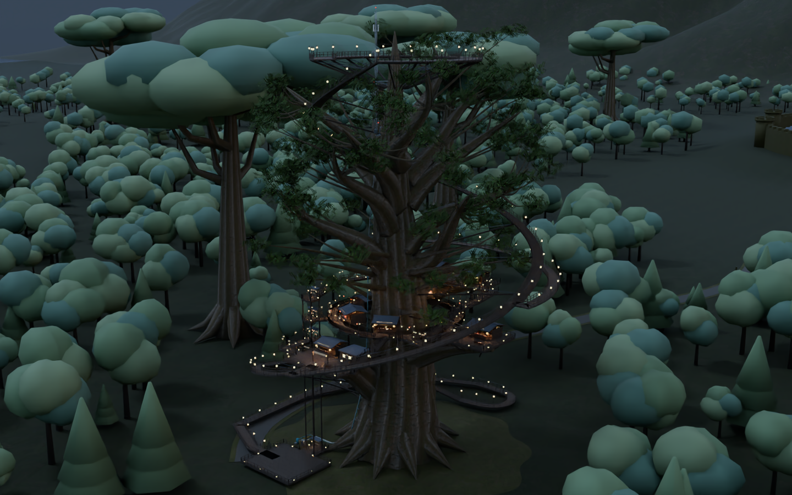
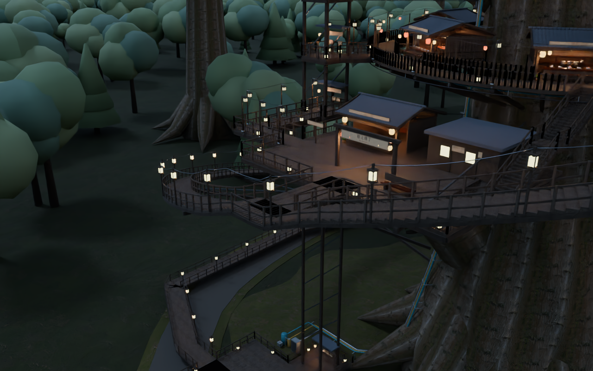

# 樹上横丁 / Tree-top Yokocho

Windows向けVRChatワールドの編集用Unity制作ソースです。ユーザー提供の設定資料と既存v2.0制作物を引き継ぎ、現実的な木造の質感と幻想的な眺望を作っています。

## v2.4.0 地上〜樹冠の連続階段

- 巨木の横丁、8店舗・49席、4デッキ、環状路、暖簾と提灯
- 真下に森林と同規模の巨木。北は街道・円形城郭都市・雪山、南は海と島
- 外周、内周、階段側面の見えない非トリガー落下防止Collider
- 実壁に通路が切られていた2か所を修正し、障害物を差し引く通路検査を追加
- Unity2022.3.22f1 / Built-in / VRChat Worlds SDKを想定

約50MBは最終Windowsワールドの目標です。ソースZIP容量ではありません。実ビルド容量は未測定です。

Unity / Udon / Shaderのコンパイル、ベイク、VRChat Build & Test、VR実機試験は未実行です。

遠景は配置確認段階です。樹冠、城郭、雪山・海岸のリアルな質感と細部は制作中です。

地上設備から幹へ続く水道・ガス・電線、60本の電灯と配線、通信設備・点滅障害灯を追加。

地上から高さ112mの樹冠まで749段の連続階段、109灯と電線、既存デッキへ接続する橋を追加。実メッシュの身体余裕・床支持検査に合格。

## プレビュー

同梱モデルのBlender形状・材質プレビューです。Unity／VRChat実機画面ではありません。

## 導入・検査

VCCで新規Worldsプロジェクトを作り、Assets/TreeTopYokochoをコピー。Tools → TreeTop Yokocho → 1 - Build Worldを実行します。

- [導入手順](Docs/SETUP_JA.md)
- [今回の変更と画像](Docs/RELEASE_NOTES_2.4.0.md)
- [実行済み検査](Docs/Validation.md)
- [実機で必要な確認](Docs/ACCEPTANCE_JA.md)
- [Unity設定と安全性](Docs/UnityAudit.md)
- [再生成コード](Source/build_world.py)

## 出典

設定: 樹上横丁_設定資料一式_v1.zip。既存制作物: TreeTopYokocho_VRChat_v1.zip（内容はv2.0高精細版）。PBRスキャン4セットはPoly Haven CC0。[出典とライセンス](Docs/ThirdParty/PolyHaven.md)

[VRChat推奨Unity](https://creators.vrchat.com/sdk/upgrade/current-unity-version/)
