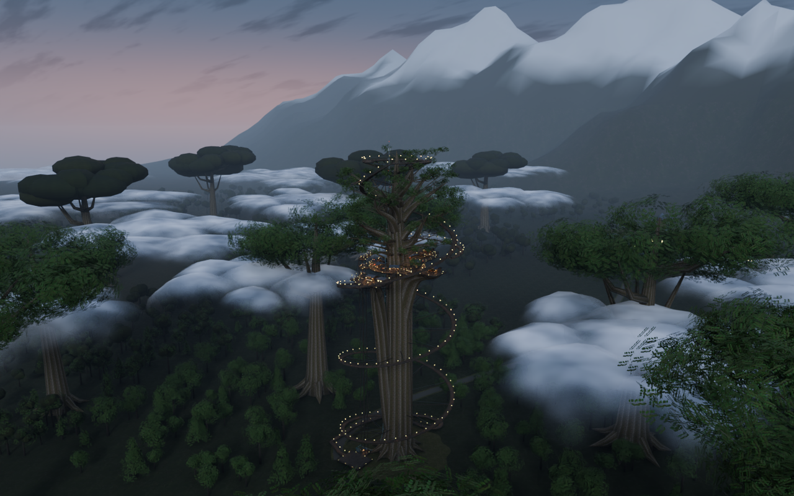
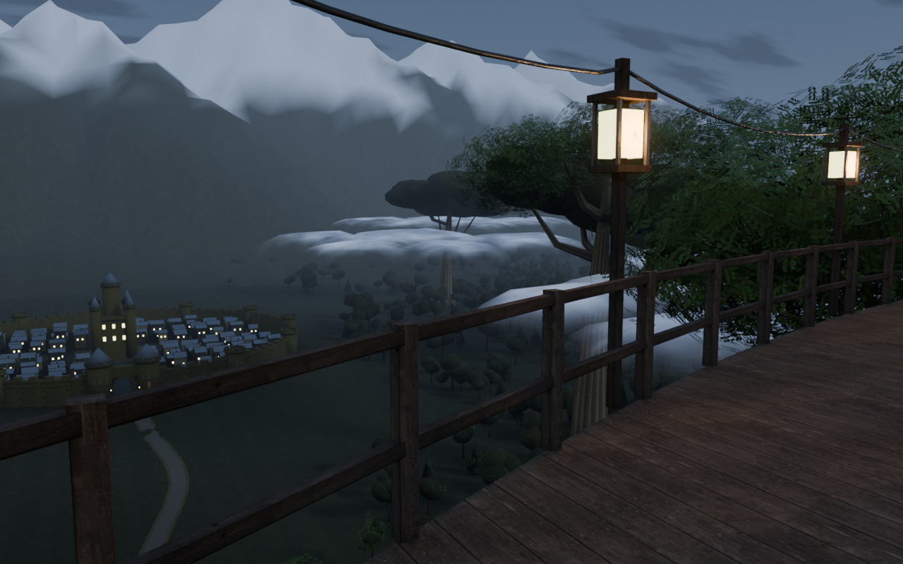

# 樹上横丁 / Tree-top Yokocho

Windows向けVRChatワールドの編集用Unity制作ソースです。ユーザー提供の設定資料と既存v2.0制作物を引き継ぎ、現実的な木造の質感と幻想的な眺望を作っています。

## v2.13.0 雲海の厚み

横丁の下の雲を、上端と水平方向の切れ間を維持したまま下へ厚くしました。横から見える肩の量感を増やし、階段・北の城郭・南の海への実際の開口を維持しています。[雲の改修と検査](Docs/CloudDepth.md)

雲の8描画バッチのZ座標だけを変更。三角形・バッチ数、新しい画像・ライト・シェーダーは増やさず、他の1,047描画バッチと当たり判定・49席・12階層移動先を維持しています。

- 巨木の横丁、8店舗・49席、4デッキ、環状路、暖簾と提灯
- 真下に森林と同規模の巨木。北は街道・円形城郭都市・雪山、南は海と島
- 外周、内周、階段側面の見えない非トリガー落下防止Collider
- 実壁に通路が切られていた2か所を修正し、障害物を差し引く通路検査を追加
- Unity2022.3.22f1 / Built-in / VRChat Worlds SDKを想定

約50MBは最終Windowsワールドの目標です。ソースZIP容量ではありません。実ビルド容量は未測定です。

Unity / Udon / Shaderのコンパイル、ベイク、VRChat Build & Test、VR実機試験は未実行です。

近い樹冠を葉の形状へ置き換え、城門・城壁・海岸の細部を追加。雲の切れ間から森林・街道・城郭都市・海を望めます。遠景とVR表示の仕上げは継続して確認が必要です。

地上設備から幹へ続く水道・ガス・電線、横丁の56本の電灯と配線、通信設備・点滅障害灯を追加。

横丁の実際の床を100m持ち上げ、標高134〜152mへ移設。地上は0mのまま、212mの樹冠まで1,416段の連続階段と配線を再構成。実メッシュの身体余裕・床支持を再検査。

実形状で93.816〜123.604mの雲海を配置（最大揺れ込み124m未満）。地上・52m・102mの3段階ポンプ設備、155mの貯水台と6基の多段ポンプを接続。設備は景観演出であり、実際の揚水性能を認証したものではありません。

中央の環状路内側へ、四方に開いた能舞台風の演技床と屋根を追加。周囲の床と連続し、身体余裕・頭上・視線を検査。

## プレビュー

同梱モデルのBlender形状・材質プレビューです。Unity／VRChat実機画面ではありません。

舞台の瓦と雪山は[v2.12の画像](Docs/RELEASE_NOTES_2.12.0.md)に記録しています。

夕空と海の調整は[v2.11の画像](Docs/RELEASE_NOTES_2.11.0.md)に記録しています。

鉢と植物の細部は[v2.10の画像](Docs/RELEASE_NOTES_2.10.0.md)に記録しています。

瓦・雨樋・料理の仕上げは[v2.9の画像](Docs/RELEASE_NOTES_2.9.0.md)に記録しています。

板床と店員入口は[v2.8の画像](Docs/RELEASE_NOTES_2.8.0.md)に記録しています。

8店舗の意匠と器の制作過程は[v2.7の画像](Docs/RELEASE_NOTES_2.7.0.md)に記録しています。

雲海・連続階段・北と南の遠景は[v2.6の画像](Docs/RELEASE_NOTES_2.6.0.md)に記録しています。

## 導入・検査

VCCで新規Worldsプロジェクトを作り、Assets/TreeTopYokochoをコピー。Tools → TreeTop Yokocho → 1 - Build Worldを実行します。

- [導入手順](Docs/SETUP_JA.md)
- [今回の変更と画像](Docs/RELEASE_NOTES_2.13.0.md)
- [実行済み検査](Docs/Validation.md)
- [実機で必要な確認](Docs/ACCEPTANCE_JA.md)
- [Unity設定と安全性](Docs/UnityAudit.md)
- [再生成コード](Source/build_world.py)

## 出典

設定: 樹上横丁_設定資料一式_v1.zip。既存制作物: TreeTopYokocho_VRChat_v1.zip（内容はv2.0高精細版）。PBRスキャン4セットはPoly Haven CC0。[出典とライセンス](Docs/ThirdParty/PolyHaven.md)

[VRChat推奨Unity](https://creators.vrchat.com/sdk/upgrade/current-unity-version/)
